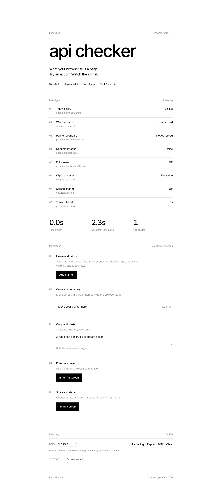

# api checker

Live browser signals, a hands-on playground, and JSON event logs.

**Live:** https://api.knhdixh.com



## Features

- Eight signals: visibility, focus, pointer boundary, `hasFocus()`, fullscreen, clipboard actions, screen sharing and timer intervals.
- Expandable API explanations and five guided actions.
- Sampled hidden/unfocused duration counters, filtered logs, markers, pause, clear and JSON export.
- Screen sharing with explicit browser approval, local preview and stop controls.
- Inter, black on white, heading reveal and the knhdixh water cursor trail. Responsive layout and reduced motion support.

Events live in memory, capped at 500. Reload clears the session. Clipboard text is never inspected; capture streams never leave the tab. Google Fonts makes external font requests.

## Run

Node 22+:

```sh
npm install
npm test
npm run check
npm run dev
```

Open http://localhost:8787. For a static-only preview without Node dependencies:

```sh
python3 -m http.server 8787 --bind 127.0.0.1 --directory public
```

HTTPS or localhost is needed for screen capture. Browser and OS permission support varies.

## Stack

Plain HTML/CSS/JavaScript, Cloudflare Workers static assets, `node:test`, Wrangler. No application backend, database, sign-in or API key is required. `/api/health` is provided by the Worker.

[Browser and extension stack](docs/STACK.md) · [Deployment](docs/DEPLOY.md) · [Verification](docs/VERIFICATION.md)

## Deploy

```sh
npm run deploy
```

`wrangler.jsonc` targets `api.knhdixh.com` on your Cloudflare account. Change its route and `CANONICAL_HOST` to use another domain. The workers.dev address redirects to that host while preserving paths and query parameters. No app secrets are needed; Wrangler requires your Cloudflare credentials.

## Limits

This reports the JavaScript values and events this page observes. It does not identify the application you switch to or inspect native software. Extensions, iframes, browser scheduling, mobile pointers and OS policies can produce different behavior. Suppressed events plus delayed samples can cause duration counters to miss transitions. Extension claims in the docs have sources, but no installed-extension verification was performed.
